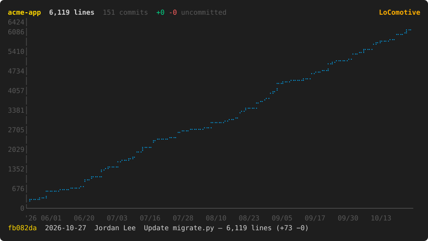
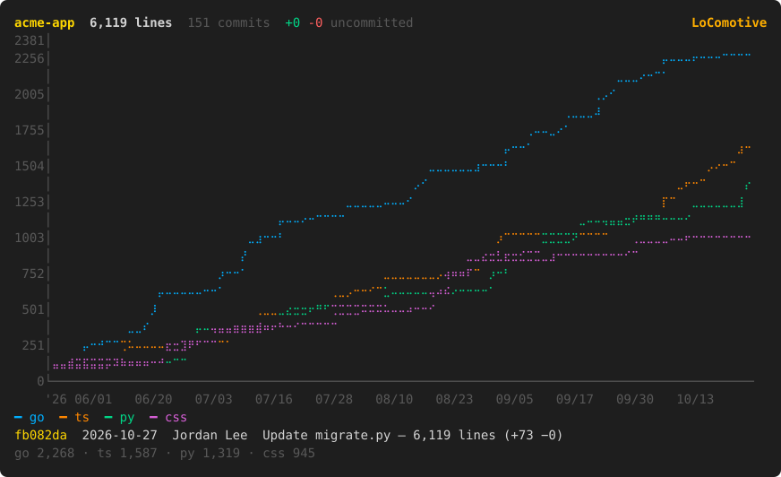
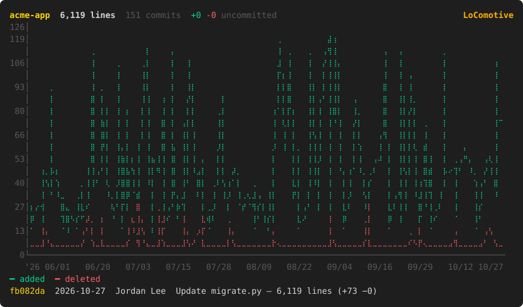
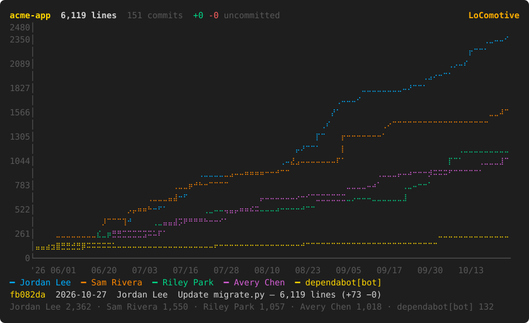
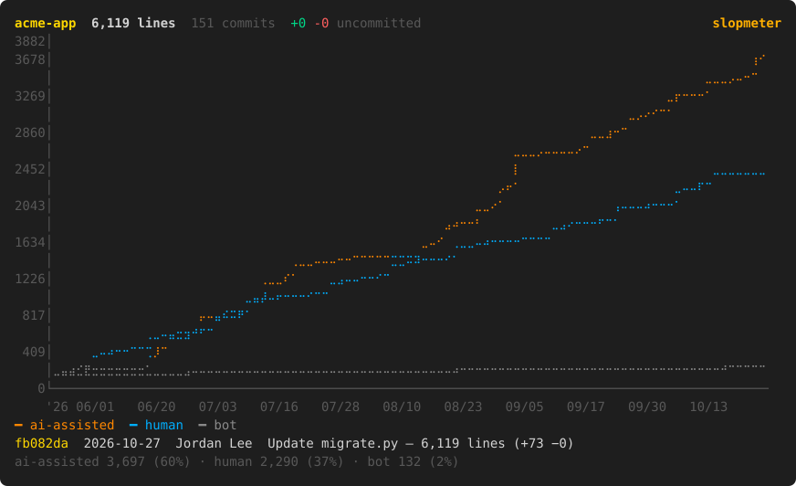
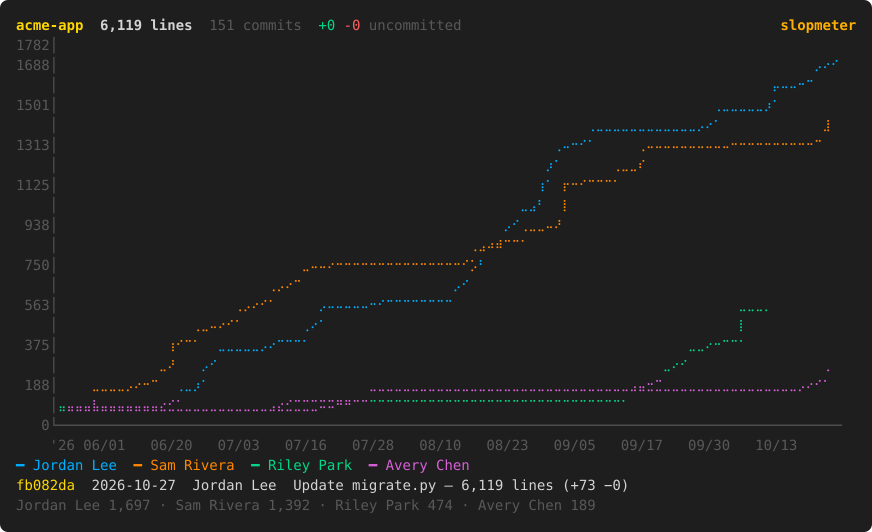

# LoComotive

A terminal UI that charts a git repo's lines of code over time, per commit and live as you edit. Watch your lines roll in, and how much of the train is being driven by AI, especially when agents are writing the code.

## All aboard

With Go:

```sh
go install github.com/danharasymiw/locomotive@latest
```

Or grab a prebuilt binary from the [releases page](https://github.com/danharasymiw/locomotive/releases).

## Use

```sh
cd your-repo
locomotive
```

`tab` cycles between three views:

- **history** plots lines of code at every commit. `m` switches between *total*, *languages* (one line per extension, plus a total), *churn* (lines added vs deleted per commit), *authors* (running net lines per person, mailmap-aware), *human vs ai* and *who uses ai* (one line per person: their running lines added in AI-assisted commits, bots excluded). The AI split classifies a commit as AI-assisted when a trailer, a message footer (such as `Generated with Claude Code`) or the author or committer identity names a coding agent (Claude, Copilot, Cursor, Aider, Codex, Gemini and similar), so commits without any of those count as human. Commits by automation accounts (`dependabot[bot]`, `renovate-bot` and similar) form a separate *bot* group.
- **live** plots your working tree (uncommitted changes plus untracked files) once a second.
- **worktrees** plots net uncommitted lines for every worktree of the repo at once, one line per branch line. A worktree is tagged `[session]` when a `claude` process is running in it and `[agent]` when git has it locked, which is how Claude Code subagent worktrees appear.

In the history view, move the cursor with `←`/`→` (`shift` jumps 10 commits) or the mouse to see the commit behind each point. `p` cycles the history window (1m, 3m, 6m, 1y, all), `r` rebuilds from scratch, `q` quits.

### Departures board

These come from a made-up repo, so no real names or code are shown. Switch between them with `m`.

**total**: lines of code at every commit.



**languages**: one line per file extension.



**churn**: lines added vs deleted per commit.



**authors**: running net lines per person.



**human vs ai**: net lines from human, AI-assisted and bot commits.



**who uses ai**: each person's running lines added in AI-assisted commits.



### Timetable

| Flag | Meaning |
| --- | --- |
| `--ext go,ts` | only count these extensions |
| `--exclude '**/*.pb.go'` | extra globs to ignore |
| `--branch main` | branch or ref to walk (default `HEAD`) |
| `--author me` | only commits by this author |
| `--since 6m` | history window: `1m`, `3m` (default), `6m`, `1y`, `all` or a date like `2025-01-01` |
| `--once` | print the chart once and exit (`--mode total\|languages\|churn\|worktrees`) |
| `--json`, `--csv` | print per-commit data and exit |

Lockfiles, vendored dependencies, build output and common generated code (protobuf, minified JS and so on) are ignored by default. See `excludes` in `git.go`. Paths marked `linguist-generated` or `linguist-vendored` in `.gitattributes` are ignored too. Git applies the current attributes to the whole history, and needs 2.13 or newer.

The commit log is cached once per repo in your user cache directory. Later runs read only new commits, and a wider window reads only the older range it is missing, so a long history is slow only the first time.

## Limits

- Line counts are cumulative added minus deleted lines, not a scan of each checkout, so they're an approximation.
- With `--branch`, `--author` or `--since`, the live view still measures against `HEAD`.
- `[agent]` detection relies on Claude Code locking worktrees of running agents.

## License

MIT
